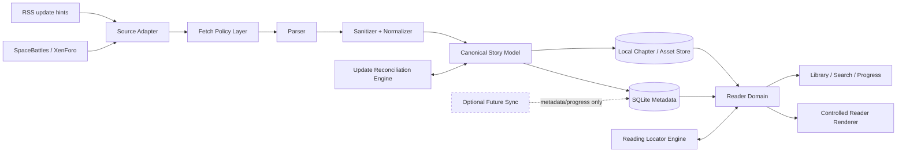
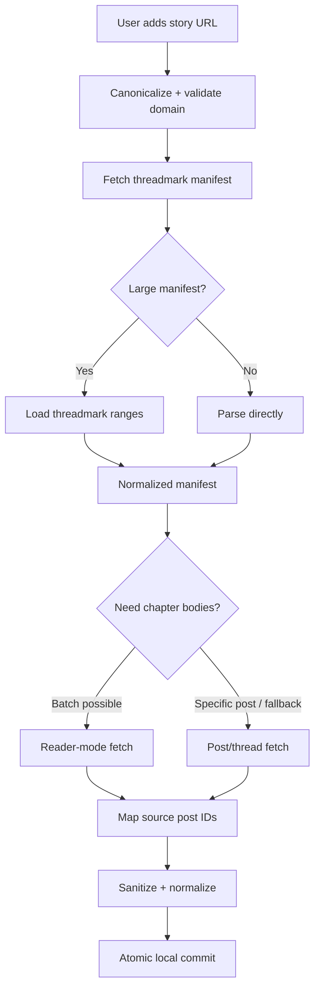
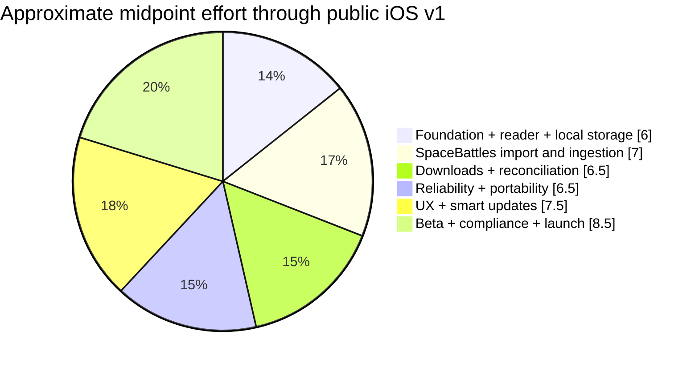
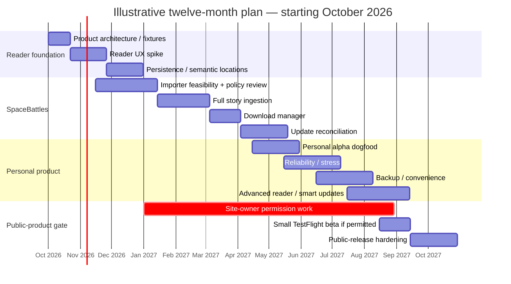

# Personal-First SpaceBattles/XenForo Fanfiction Reader: Product, Technical, and Commercial Development Plan

## Executive summary

A personal-first SpaceBattles reader is **technically feasible, strategically sensible as a personal project, and potentially viable as a niche public product**, but the project has one unusually important constraint: **technical feasibility is much clearer than public-distribution permission**.

SpaceBattles already exposes most of the structural primitives a reader needs. Its current XenForo ecosystem provides threadmarks, Reader mode, multiple threadmark categories, range-loaded indexes, and per-thread/per-category RSS capability. The upstream Threadmarks Pro add-on explicitly documents Reader mode and RSS feeds, while mature open-source software such as FanFicFare has been consuming SpaceBattles/XenForo fiction for years. FanFicFare even uses Reader-mode pages to reduce full-story request volume by roughly an order of magnitude. citeturn21search5turn0search2

The market, however, is **fragmented rather than empty**. As of September 13, 2026, [Fan Reader](https://apps.apple.com/us/app/fan-reader/id6759957355) is an iOS reader that explicitly supports SpaceBattles and several other fiction sites; its App Store listing currently shows only five ratings, so there is insufficient evidence of broad adoption. [FicHub](https://fichub.net/) provides browser-based EPUB and other exports for SpaceBattles and other sites. [FanFicFare](https://github.com/JimmXinu/FanFicFare) is a mature Calibre plugin/CLI with active 2026 releases and sophisticated XenForo handling. Community threads going back years repeatedly show the same pain point: readers dislike consuming long forum fiction in mobile browsers and resort to exporters, Calibre, Pocket-like workflows, or one-off tools. citeturn0search0turn12search9turn1search7turn12search0turn12search2turn11search3

That means the product opportunity is **not “nobody has solved this.”** The opportunity is:

> **Make the best long-form mobile reading experience for threadmarked web fiction, while retaining a reliable link back to the source community.**

The defensible part of such a product is unlikely to be HTML scraping. It would be the combination of a polished reader, robust update reconciliation, stable position tracking, offline-first storage, nuanced handling of Threadmarks/Sidestories/Apocrypha/Informational posts, source portability, and eventually a clean multi-site adapter model.

My principal architectural recommendation remains **React Native + Expo + TypeScript**, particularly given a Windows-based development environment and the possibility of Android later. Expo can build iOS binaries in the cloud from Windows or Linux; SwiftUI remains an excellent alternative if the product becomes permanently Apple-only and a Mac becomes part of the development setup. Expo provides persistent SQLite, filesystem access, secure storage, development builds, cloud signing/builds, and App Store submission tooling. citeturn25search3turn25search4turn25search5turn26search3turn26search5

The canonical application architecture should be:



The most important design decision is that **SpaceBattles HTML must never become the application's domain model**. Imported content should be converted into a normalized story/chapter/block representation with stable source identifiers. That lets the importer break and be repaired independently of the reader, and eventually permits SpaceBattles, Sufficient Velocity, EPUB, AO3, Royal Road, and other sources to feed the same library.

I would retain the earlier 0–24 roadmap, but treat it as five maturity bands rather than a promise to build all 25 phases:

| Finish line | Phases | Approx. cumulative engineering effort* | Meaning |
|---|---:|---:|---|
| Reader proof | 0–2 | 4.5–7.5 person-weeks | Reading experience and local persistence proven |
| Personal SpaceBattles app | 3–7 | 15.5–26.5 cumulative | You routinely prefer it to Safari |
| Excellent personal product | 8–12 | 27.5–48.5 cumulative | Reliable, portable, polished |
| Public iOS product | 13–15 | 33.5–59.5 cumulative | Permission, beta, App Store-quality release |
| Multi-source platform | 16–24 | 83.5–158.5+ cumulative | Cross-site, sync, discovery, platform services |

\*Planning estimates, not vendor claims. One person-week means roughly one full-time engineering week. Estimates assume substantial AI coding assistance but still include design, review, testing, migrations, device QA, and debugging.

The strongest first-year strategy is therefore **not** “build the platform.” It is:

**Reader → local persistence → real SpaceBattles importer → robust ingestion → downloads → update reconciliation → use it personally → stress it → then decide whether public distribution is justified.**

Public release should be a deliberate gate because Apple's current Guideline 5.2.2 says that an app using, accessing, monetizing access to, or displaying content from a third-party service must be specifically permitted to do so under that service's terms, and Apple may request evidence of authorization. citeturn24view0

A major research limitation matters here: **I could not directly retrieve and verify SpaceBattles' current Terms page or its current `robots.txt` through this research environment.** Search results reproduce older/currently indexed language indicating users retain copyright in their content, but that is not adequate evidence that automated third-party app access is permitted. citeturn27search1 Therefore, automated-access rules, acceptable request rates, branding, and public client permission should be confirmed directly with SpaceBattles before a public beta.

The business thesis should consequently remain conservative:

> **Build something worth using even if it never becomes a business. Productize only after permissions and retention validate the next step.**

That makes the downside unusually attractive: a failure to find a market can still produce a genuinely useful personal application and a substantial engineering portfolio project.

**Planning inputs currently unspecified**

| Input | Status | Recommended planning assumption |
|---|---|---|
| Target public launch | **Unspecified** | No fixed date; public launch conditional on site permission and quality gate |
| Team size | **Unspecified** | Base estimates assume one full-time-equivalent engineer/product owner with AI assistance |
| Budget | **Unspecified** | Local-first/minimal-infrastructure approach |
| Initial platform | Inferred from conversation | iPhone first |
| Initial source | Defined | Public SpaceBattles threadmarked fiction |
| Android | Unspecified | Preserve architectural option; do not build in first personal milestone |
| Monetization | Unspecified | None until post-beta evidence |
| Public-company ambition | Unspecified | Treat as optional rather than assumed |

## Market landscape and strategic position

There are already four recognizable approaches to the SpaceBattles-reading problem: read the forum directly; use a dedicated reader; export a story to an ebook; or use desktop tooling to manage/update a local ebook library.

SpaceBattles' own threadmarked interface is therefore both a competitor and the source system. Search-indexed SpaceBattles pages currently expose `Threadmarks`, `Reader mode`, and `RSS` controls, and the upstream XenForo Threadmarks Pro implementation explicitly supports a threadmark index, next/previous navigation, Reader mode that shows only threadmarked posts, custom posts per reader page, range loading for large threadmark lists, and per-thread/per-category RSS feeds. citeturn21search0turn21search5

Fan Reader is the closest direct product competitor. Its App Store description advertises SpaceBattles, Sufficient Velocity, AO3, Royal Road, FanFiction.net and Wildbow serials; it advertises a unified library, reading progress, chapter navigation, adjustable typography/themes, URL import and chapter preloading, and says no account is required and story content is not stored on its servers. As of this research, its listing shows five ratings and a 4.2 score. That is interesting evidence of a current product entering the niche, but far too little evidence to infer its retention, sales, install base, or quality. citeturn0search0

FicHub attacks the problem indirectly: give it a supported story URL and export the result to EPUB or other formats. Its supported-site list includes SpaceBattles, Sufficient Velocity and Questionable Questing, among many others. Its model has a powerful UX advantage—users can read in Apple Books or another mature EPUB reader—but exported stories are less naturally integrated with source-site updates and forum-specific categories. FicHub's public issue tracker also contains reports of story-update/import failures and a long-running request to improve handling of categories such as Apocrypha, Sidestory and Informational; these should be treated as individual issue reports, not proof that the service broadly fails. citeturn12search9turn1search1turn1search4

FanFicFare is the most important technical incumbent. It exists as both a Calibre plugin and command-line tool, has active releases through September 2026, and contains years of XenForo-specific behavior and workarounds. Its recent releases include fixes specifically involving XenForo Reader-mode post lookup. citeturn1search7 Historically, the now-retired Omnibuser served a similar SpaceBattles/Sufficient Velocity export use case, which shows that offline conversion predates today's tools. citeturn11search3

The community evidence is modest but consistent. Recent Reddit discussion includes a developer describing frustration with SpaceBattles on mobile and considering building an app because they could not find a satisfying combination of bookmarking, reading lists and collections. Older readers describe using FanFicFare, FicHub and similar conversion workflows specifically because reading forum-format stories on phones is awkward. Those conversations establish **pain**, but they do not establish a large addressable paying market. citeturn12search0turn12search2turn12search8turn12search22

**Competitor and substitute matrix**

| Capability | SpaceBattles web | [Fan Reader](https://apps.apple.com/us/app/fan-reader/id6759957355) | [FicHub](https://fichub.net/) | [FanFicFare / Calibre](https://github.com/JimmXinu/FanFicFare) | Proposed reader |
|---|---|---|---|---|---|
| iPhone-first dedicated reader | No; browser UI | **Yes** | No; exporter | No; desktop/CLI workflow | **Yes** |
| Direct SpaceBattles support | Native source | **Yes** | **Yes** | **Yes** | **Yes** |
| Long-form typography controls | Forum/Reader mode | **Yes**, per listing | Delegated to EPUB reader | Delegated to ebook reader | **Core competency** |
| Reading progress | Forum/browser state | **Yes**, per listing | Delegated | Delegated | **Yes, semantic locator** |
| Offline-first library | Not core | Some local/preloading behavior advertised; full semantics unclear | Via exported ebook | Via local ebook | **Explicit design goal** |
| New-story/chapter refresh | Live website | Exact reconciliation behavior unverified | Re-export workflow | Mature update workflow | **Stable-ID reconciliation** |
| Threadmark categories | Native | Unverified | Partial/known open request | **Yes** | **Yes, first-class** |
| Sidestory/Apocrypha control | Native category UI | Unverified | Imperfect/issue exists | Supported by XenForo adapter | **Custom reading-order goal** |
| EPUB export | No | Not advertised | **Yes** | **Yes** | Later portability feature |
| Multi-site | SpaceBattles only | **Yes** | **Yes** | **Yes** | Adapter-based, later |
| Story content centrally hosted | Source itself | Listing says not on Fan Reader servers | Service processes exports | No central service required | **No, by default** |
| Cross-device sync | Website account behavior | Not prominently advertised | External reader-dependent | External ecosystem | Later optional service |
| Forum comments/discussion | **Yes** | Source link expected | No | No | Deliberately links back to source |
| Source-specific reading-order intelligence | Native | Unknown | Limited | High technical awareness | **Potential differentiation** |

Competitor details above are based on the current product listings/documentation and public issue trackers rather than independent usability testing. citeturn0search0turn12search9turn1search1turn1search7

The strategic positioning should therefore avoid “all fanfiction in one app” during the wedge phase. That immediately pits the project against generalized ebook readers, AO3 tooling, mature exporters and the new Fan Reader.

A stronger wedge is:

> **The best reader for threadmarked forum fiction.**

That has concrete source-specific capabilities a generic reader cannot easily replicate: category-aware reading order, update detection tied to individual posts, linked-thread handling, “updated since you read this” semantics, source discussion links, and preservation of unusual forum formatting.

The product can then expand outward:

```text
SpaceBattles
    ↓
XenForo/threadmarked fiction
    ↓
General web-fiction reader
    ↓
Cross-device fiction library
```

The key commercial caveat is **market size remains unvalidated**. Five App Store ratings for a current competitor and a collection of Reddit/forum threads do not provide a credible total-addressable-market estimate. Investor conversations should describe this as a **validated pain point with an unvalidated market**, not as an obviously large opportunity.

## Technical architecture and reader experience

**Recommended stack: React Native + Expo unless the project becomes permanently iOS-only.**

React Native provides a cross-platform native application model, while Expo's current tooling makes the Windows situation unusually favorable: EAS can compile iOS development and production builds in the cloud from any operating system, and EAS Submit can send iOS builds to App Store Connect from Windows or Linux. citeturn25search3turn25search5 SwiftUI is Apple's native declarative framework and offers excellent integration across Apple platforms, but current Xcode releases require supported versions of macOS, so a SwiftUI-first workflow would materially increase development friction without a Mac. citeturn26search2turn26search4

| Criterion | React Native + Expo | SwiftUI | Recommendation for this project |
|---|---|---|---|
| Windows primary development | **Strong**: EAS iOS cloud builds from any OS citeturn25search3 | **Weak**: Xcode requires macOS citeturn26search4 | Expo |
| iOS-native integration | Strong; native modules available | **Excellent** | SwiftUI edge |
| Future Android | **Shared app architecture** | Separate implementation required | Expo |
| TypeScript familiarity/ecosystem | **Strong** | N/A | Expo |
| Reader prototype speed | **High** | High with Mac | Expo |
| Local SQLite | `expo-sqlite` persists across restarts citeturn26search5 | SQLite/Core Data/SwiftData options | Tie |
| Secure credentials | `expo-secure-store` suitable for small secrets citeturn26search3 | Keychain | Tie |
| Cloud build/signing | Integrated EAS path citeturn25search4 | Native Xcode/App Store path | Expo from Windows |
| Long-term Apple-specific polish | Good | **Best-in-class** | SwiftUI if scope becomes Apple-only |
| Platform-risk concentration | Expo/RN dependencies | Apple-only dependency | Depends on strategy |

The recommended architecture is explicitly **local-first**. Expo's own local-first guidance identifies SQLite as an appropriate local data store, and `expo-sqlite` persists data across application restarts. citeturn26search3turn26search5 No account, server database or cloud story cache is required for the personal application.

A useful initial schema would resemble:

```text
Source
  id
  adapterVersion
  baseUrl

Story
  id
  sourceId
  sourceThreadId
  canonicalUrl
  title
  author
  manifestVersion
  lastCheckedAt

Category
  id
  storyId
  sourceCategoryId
  type
  displayName
  sortOrder

Chapter
  id
  storyId
  sourcePostId
  sourceCategoryId
  canonicalUrl
  title
  author
  sourcePublishedAt
  currentVersionId
  orderKey

ChapterVersion
  id
  chapterId
  normalizedContentHash
  importedAt
  sourceModifiedAt
  contentLocation

ReadingLocation
  storyId
  chapterId
  chapterVersionId
  semanticBlockId
  textQuote
  prefix
  suffix
  localOffset
  chapterProgression

Asset
  id
  chapterVersionId
  sourceUrlHash
  localPath
  mimeType
  downloadState

DownloadJob
  id
  storyId
  state
  retryCount
  createdAt
```

**Do not make chapter number the identity.** “Chapter 42” may become Chapter 43 after an insertion. A much stronger identity is something such as:

```text
source = "spacebattles"
thread = 123456
post = 9876543
```

Ordering becomes mutable metadata around a stable source post.

Likewise, content versioning should be distinct from chapter identity:

```text
chapter identity = source + post ID
content version  = normalized-content hash
```

That lets the application recognize:

> “This is still the chapter you read, but its text has changed.”

without duplicating the chapter.

**The reader should store a normalized semantic representation, not merely saved HTML.**

A good internal representation might consist of blocks such as:

```text
Paragraph
Heading
SceneBreak
Quote
Spoiler
Image
List
Code
Link
EmbeddedMediaPlaceholder
```

The importer transforms source HTML into these blocks. A deterministic renderer transforms those blocks into the actual reading view.

That boundary is valuable for three reasons: it reduces dependency on SpaceBattles CSS, makes sanitization easier, and permits a future native renderer without reparsing the source.

**WebView versus fully native rendering**

For the first working reader, a controlled WebView remains the pragmatic choice because forum stories contain rich HTML-like formatting, quotes, spoilers and images. But the WebView should render **HTML generated by us from sanitized normalized content**, not a live SpaceBattles page.

| Approach | Strength | Weakness |
|---|---|---|
| Live website in WebView | Very easy | Essentially recreates the browser problem; inherits tracking, navigation and source scripting |
| Sanitized local HTML in WebView | **Fastest high-fidelity MVP**; CSS typography; natural links/images | Web security boundary; selection/accessibility require careful testing |
| Pure React Native/native blocks | Excellent app control and accessibility integration | Considerably more renderer engineering; forum markup edge cases |
| EPUB/Readium renderer | Excellent future ebook interoperability | Dynamic threadmark/import semantics do not naturally map to the whole product |

OWASP explicitly treats content entering a WebView as untrusted and calls out XSS risks, while its mobile security controls require validation and sanitization of untrusted network input. citeturn22search5turn22search25 The implication is clear: **remote scripts should never survive import; navigation and external resources should be controlled; and sanitization must be allow-list based.**

Readium is worth watching for EPUB interoperability rather than making it the initial core renderer. Its locator architecture is particularly relevant: Readium combines publication/resource identity, progression, structural fragments and textual context, and notes that purely structure-tied locators can become fragile when a resource changes. citeturn19search3turn19search4

That leads to one of the most important reader-engine recommendations: **position persistence should use redundant semantic anchors.**

A saved position should contain:

```text
story ID
chapter/post ID
chapter content-version ID

semantic block ID
local character offset

exact nearby text
text before
text after

fallback chapter progression 0.0–1.0
```

Restoration would then proceed approximately:

```text
same version?
    → exact block + offset

version changed?
    → exact text quote
    → prefix/suffix-assisted text match
    → nearest semantic block
    → percentage fallback
```

This is vastly more robust than saving `scrollY = 18,432`, because changing font size, device orientation, margins or chapter content changes pixel geometry.

**Long-form UX should be aggressively content-first.**

WCAG 2.2 provides useful benchmarks: normal text should meet at least 4.5:1 contrast, large text at least 3:1; users should be able to resize text substantially without loss of content; reflow and text-spacing adjustments should not break content. Its visual-presentation guidance also favors controllable foreground/background, reasonable line length and non-justified text. citeturn18search7 Apple's text APIs support Dynamic Type and scalable preferred text styles, which should be honored even if the reader also provides its own typography controls. citeturn18search3turn18search4

The target reader experience should therefore include:

**Reading surface.** User-controlled font family/size, line height, text width/margins and themes; no forced full justification; minimal persistent chrome; tap or scroll to reveal controls.

**Progress.** Distinguish chapter progress from story progress. Display chapter title and reading order without allowing those values to become persistence identifiers.

**Spoilers.** Preserve them as actual disclosure controls. Their collapsed/expanded state can be persisted locally. Nested spoilers must not silently flatten.

**Quotes.** Make quoted material visually distinct without recreating bulky XenForo quote boxes. Preserve quoted author/context where it carries meaning.

**Images.** Cache user-requested story images locally, keep aspect ratio, offer tap-to-zoom, preserve source alt text when present, and show a meaningful failure placeholder instead of a blank hole.

**External media.** Prefer a safe placeholder plus “Open source media” over automatically executing third-party embeds.

**Accessibility.** Test with VoiceOver, very large text, reduced motion and increased contrast. Interactive spoiler controls must expose meaningful accessibility labels and states.

**Text-to-speech.** This belongs later, but the architecture should make it straightforward by producing clean normalized textual content rather than trying to speak raw forum HTML. Apple's speech synthesizer can speak supplied text and supports voice/rate control and pause/resume behavior. citeturn18search1turn18search2

**Search.** SQLite full-text search can eventually index local normalized chapter text; Expo's SQLite package includes FTS support. citeturn26search5 This should remain local by default.

The UX benchmark for the personal-alpha gate is not “it works.”

It is:

> **You are halfway through a 300,000-word story and no longer think about the app.**

## Importing, reliability, security, and compliance

The importer is the highest-risk engineering subsystem, but existing ecosystem behavior demonstrates that the problem is tractable.

SpaceBattles is currently on XenForo 2.3, and the Threadmarks Pro ecosystem supports XenForo 2.2/2.3. Threadmarks Pro documents Reader mode, range-loaded threadmark indexes and per-thread/per-category RSS. citeturn4search10turn21search5 FanFicFare's current XenForo adapter recognizes categories including Threadmarks, Sidestory, Apocrypha, Omake, Media, Informational and Staff Post. citeturn14search0

FanFicFare also documents a significant optimization: fetching through Reader mode can reduce the number of pages needed for a full story by roughly 10:1 compared with normal thread traversal. citeturn0search2

That suggests a three-tier import strategy:



**The source-adapter interface should be narrow.**

Conceptually:

```ts
interface FictionSourceAdapter {
  canHandle(url: URL): boolean;

  canonicalize(url: URL): Promise<CanonicalStoryReference>;

  fetchManifest(
    reference: CanonicalStoryReference
  ): Promise<StoryManifest>;

  fetchContent(
    requests: ChapterContentRequest[]
  ): Promise<ImportedChapter[]>;

  fetchUpdateHints?(
    reference: CanonicalStoryReference
  ): Promise<UpdateHint[]>;

  getCapabilities(): SourceCapabilities;
}
```

The rest of the application should never know whether a SpaceBattles threadmark list came from a normal page, range-loading endpoint, Reader page or future API.

**RSS is an update hint, not canonical state.**

The current Threadmarks Pro documentation says RSS is per-thread/per-category, and historical release notes document a configurable feed fetch limit. citeturn21search5turn21search2 A FanFicFare feature request also identifies concrete SpaceBattles threadmark-feed URLs. citeturn21search1

Therefore:

```text
RSS says “something probably changed”
        ↓
app fetches/reconciles authoritative manifest
        ↓
new/renamed/reordered/deleted items resolved
```

Do not treat “not present in latest RSS entries” as deletion.

**Update reconciliation should be transactional and idempotent.**

Suppose the old manifest is:

```text
post 10  Chapter One
post 20  Chapter Two
post 30  Sidestory A
```

and the refreshed manifest becomes:

```text
post 10  Chapter One
post 15  Interlude
post 20  Chapter Two — Revised
post 30  Sidestory A
```

The reconciliation engine should:

1. retain posts 10/20/30 and their reading metadata;
2. insert post 15;
3. update the title/order metadata for post 20;
4. fetch post 20 only when version checking indicates content changed or policy requires refresh;
5. recompute display ordering;
6. commit the manifest change atomically.

Repeating the same refresh should yield **zero additional changes**.

Deletions should initially become a tombstone such as `sourceUnavailable`, not immediate local deletion. That gives the user understandable behavior if a post temporarily becomes inaccessible.

**Recent real-world issues show why this abstraction matters.**

FanFicFare's 2026 releases include XenForo Reader-mode post-lookup fixes, and its issue tracker contains recent cases in which particular SpaceBattles stories or posts generated 403/lookup failures while other stories still worked. citeturn1search7turn20search6turn20search1 This does not imply that SpaceBattles importing is generally unreliable; it does demonstrate that naïvely calculating Reader pages or assuming every post behaves identically will eventually fail.

FanFicFare also contains browser-cache and proxy-oriented workarounds for sites that block automated downloading. citeturn20search2 For this project, that should be read as a warning, **not a roadmap to anti-bot circumvention**.

The public application should follow this hierarchy:

```text
Normal permitted request
        ↓
Respect status/rate signals
        ↓
Back off / retry conservatively
        ↓
Surface “source currently unavailable”
        ↓
Open original in browser

NOT:

challenge detected
        ↓
attempt increasingly aggressive bypass
```

Authentication should also be **out of scope for the initial product**. Publicly accessible stories are sufficient to prove the concept. Supporting login-gated threads later would introduce credentials, cookies, private-content rules and substantially more legal/security complexity.

**Fetch policy should be centralized.**

Every source request should pass through one component implementing:

- per-domain concurrency caps;
- configurable minimum request spacing;
- exponential backoff with jitter;
- `Retry-After` handling where supplied;
- capped retries;
- cancellation;
- request deduplication;
- conditional requests when appropriate;
- identifiable application/user-agent policy if the site owner requests one;
- aggregate telemetry without story content.

No particular requests-per-second limit should be invented. **Ask SpaceBattles what is acceptable before public deployment.**

**Security requires treating every imported byte as hostile input.**

OWASP's mobile standards explicitly require apps to validate and sanitize untrusted inputs, and its WebView guidance identifies script injection/XSS as a key risk. citeturn22search5turn22search25

The ingestion boundary should therefore:

```text
allow:
  paragraphs
  headings
  emphasis
  safe links
  safe images
  quotes
  lists
  spoiler structures
  limited presentation semantics

strip:
  script
  iframe unless transformed to inert placeholder
  event handlers
  arbitrary style
  unknown active elements
  forms
  executable URLs
```

Source JavaScript must never execute merely because an author placed markup in a post.

External navigation should open through an explicit app-controlled handler rather than allowing arbitrary WebView transitions.

If authentication is ever added, credentials/session material should live in an OS-backed secure store rather than ordinary SQLite. Expo explicitly positions SecureStore for small secrets such as tokens and keys. citeturn26search3

**Reliability testing should use four distinct test layers.**

| Layer | Purpose | Typical material |
|---|---|---|
| Synthetic parser fixtures | Precise edge-case coverage | Handwritten quote/spoiler/image/malformed markup |
| Recorded regression fixtures | Prevent real parser regressions | Minimized permitted/appropriately retained source fragments |
| Generated stress corpus | Scale/crash testing | Synthetic million-word / thousand-chapter libraries |
| Live smoke tests | Verify current integration | Very small, rate-limited set; not every CI run |

Continuous integration should **not repeatedly scrape SpaceBattles**. Parser and reconciliation logic should operate overwhelmingly against fixtures. Live source checks should be manual or infrequent and respect site policy.

Core acceptance tests should include:

| Failure mode | Required test |
|---|---|
| Duplicate updates | Refresh same manifest 10 times; chapter IDs remain unique |
| App killed mid-download | Existing chapter/version remains readable and new version is either fully committed or absent |
| Network disappears | Cold-start app in airplane mode and read previously downloaded story |
| Font/theme change | Position restores to same semantic passage rather than same pixel |
| Edited chapter | Locator attempts text/context recovery against new content version |
| Deleted source post | Existing local content is not silently destroyed |
| DB migration | Upgrade from at least the prior two test schemas with progress intact |
| Huge story | Synthetic 1,000+ chapter / multi-million-word library remains navigable without loading all text into memory |
| Image failure | Text continues rendering with accessible placeholder |
| Malformed source HTML | Import fails safely or degrades gracefully; script does not execute |
| Source returns 403/429/500 | Correct classification, backoff and user-visible status |
| Background interruption | Job can resume/restart without duplicate local versions |

A proposed quality target for a personal alpha is **100% deterministic fixture pass, zero known data-loss bugs, zero duplicated chapters under repeated refresh, and successful offline cold start**. For public beta, add crash-free-session and import-success monitoring rather than relying exclusively on manual testing.

**The legal/App Store gate is more serious than the engineering gate.**

The U.S. Copyright Office explains that copyright owners hold exclusive rights including reproduction and distribution of their works; simply being publicly readable on a website does not make a work public-domain content. citeturn23search0turn23search5 Local caching for a user's reading convenience may present a different practical risk profile from centrally republishing stories, but “local-first” is **not itself a legal permission doctrine**.

Apple is unusually explicit. Guideline 5.2.2 currently says third-party-service content must be specifically permitted under the service's terms and that authorization must be supplied if Apple asks. citeturn24view0 Apple also prohibits unauthorized use of protected third-party material/trademarks under 5.2.1. citeturn24view0

This gives the project a sensible compliance sequence:

```text
Personal prototype
       ↓
Verify current SpaceBattles Terms + robots.txt manually
       ↓
Contact SpaceBattles before external/public distribution
       ↓
Agree acceptable access pattern / attribution / naming
       ↓
Retain written authorization
       ↓
Small TestFlight beta
       ↓
App Store review
```

**Current Terms/robots research limitation:** direct retrieval of the present SpaceBattles Terms page and `robots.txt` was unsuccessful in this environment. Search-indexed SpaceBattles discussions reproduce Terms language saying users retain copyright, but that is secondary evidence and not enough to determine automated-access permission. citeturn27search1 No claim should therefore be made that current SpaceBattles Terms or robots policy either authorizes or forbids this app until those documents are directly reviewed.

This uncertainty should be resolved **before Phase 13, preferably during Phase 3**, even though the personal prototype can proceed with synthetic data beforehand.

Apple adds two more public-product considerations. Its guidelines require a privacy policy for App Store apps, and its user-generated-content rules impose filtering/reporting/blocking expectations in applicable UGC/social contexts. citeturn24view1 Because SpaceBattles fiction can contain mature material, age-rating and content-handling design deserve legal/App Review attention before broad source expansion.

The safest product posture is therefore:

- unofficial branding;
- prominent source attribution;
- direct “Open discussion on SpaceBattles” links;
- no central redistribution of story bodies;
- no claiming ownership of imported fiction;
- no monetization of story access;
- no anti-bot bypass;
- no gated/private content at launch;
- a takedown/contact channel;
- clear diagnostics and privacy policy;
- written source-site permission before App Store launch.

## Phased product roadmap and first-year plan

The 0–24 roadmap remains useful because it distinguishes **product maturity from feature count**. The following estimates are intentionally broader than pure coding estimates: they include implementation, tests, debugging, documentation and device verification.

They assume one capable engineer/product owner using AI development assistance. They are **person-weeks**, not promises of calendar duration.

| Phase | Deliverable | Exit / acceptance criterion | Est. effort |
|---:|---|---|---:|
| **0 — Foundation** | Product spec, repo, architecture boundaries, fixtures, CI skeleton, legal/access questions logged | Architecture decision record exists; fake-story test corpus works; scope exclusions documented | **1–2 pw** |
| **1 — Reader UX spike** | Synthetic story reader, scrolling, typography, themes, chapter controls | You voluntarily prefer a long test session in it to Safari; no networking exists yet | **1.5–2.5 pw** |
| **2 — Persistent local reader** | SQLite, local content store, semantic reading locators, migrations | Kill/reopen restores passage; downloaded synthetic story cold-starts offline | **2–3 pw** |
| **3 — SpaceBattles importer proof** | One public SB URL → canonical manifest → selected chapter | Multiple representative public stories import; unsupported/blocked requests fail explicitly | **2–4 pw** |
| **4 — Full SB ingestion** | All major threadmark categories, rich formatting, images/spoilers/quotes | Representative corpus renders faithfully; category separation survives refresh | **3–5 pw** |
| **5 — Download manager** | Whole-story downloads, queue, progress, cancel, retries, atomic commit | Large synthetic and real permitted stories survive interruption without corruption | **2–3 pw** |
| **6 — Reconciliation engine** | New/reordered/renamed/edited/deleted post handling | Repeated refresh is idempotent; stable post IDs retain progress | **3–5 pw** |
| **7 — Personal alpha** | Cohesive library/import/update/read flow | You use it as your normal SpaceBattles fiction reader for several weeks | **1–2 pw** |
| **8 — Torture/reliability** | Stress/failure testing, malformed input, network chaos, parser hardening | No known data-loss paths; target stress corpus passes | **3–5 pw** |
| **9 — Backup/portability** | Export/import library metadata and progress; EPUB strategy | Reinstall/migration test restores reading life without manual DB surgery | **2–3 pw** |
| **10 — Convenience** | Share sheet, URL detection, library filters/search, bookmarks/history | New story can move Safari → library → reading in seconds | **2–4 pw** |
| **11 — Advanced reader** | Highlights, richer themes, optional pagination/TTS, accessibility polish | Accessibility/device test matrix passes; advanced controls do not destabilize locators | **3–6 pw** |
| **12 — Smarter updates** | RSS hinting, foreground refresh, best-effort OS background tasks | New chapters detected reliably without aggressive polling; false “no update” minimized | **2–4 pw** |
| **13 — Private external beta** | TestFlight, onboarding, diagnostics, tester program | 25–100 approved testers can self-install/use app; support load is manageable | **2–3 pw** |
| **14 — Public-release hardening** | Permission evidence, privacy, age/content strategy, App Review prep, observability | Written third-party-service authorization and compliance checklist complete | **3–6 pw + external wait** |
| **15 — Public iOS v1** | App Store release pipeline, support and release operations | Public users can install/update without developer intervention | **1–2 pw** |
| **16 — XenForo expansion** | One or more compatible threadmarked sites through same interface | New adapter requires no reader/storage rewrite | **3–5 pw/site family** |
| **17 — Non-XenForo sources** | AO3/Royal Road/etc. adapters | Source-specific parsing remains isolated; core tests unchanged | **4–8 pw/source** |
| **18 — Multi-device sync** | Progress/library/settings sync; conflict handling | Offline edits reconcile deterministically across two devices | **4–8 pw** |
| **19 — Android** | Production Android UX + platform QA | Feature-parity target passes on representative Android devices | **3–6 pw** |
| **20 — Discovery** | Metadata search/recommendation layer | Discovery demonstrably improves story acquisition without compromising reader simplicity | **6–12 pw** |
| **21 — Community/personalization** | Optional reviews/social shelves/recommendation graph | Only proceed with moderation resources and strong demand | **8–16 pw** |
| **22 — Commercialization** | Pricing/paywalls/entitlements/business analytics | Users demonstrate willingness to pay; third-party-content access itself remains unmonetized | **2–4 pw** |
| **23 — Backend platform** | Accounts, push/update service, sync operations | Backend provides measurable benefit worth added policy/security/operational burden | **8–16 pw** |
| **24 — Full platform** | Web/desktop/API/ecosystem-grade service | Separate business case exists; organization can operate it sustainably | **12–24+ pw** |

These are planning estimates produced for this report, not historical project-duration claims.

The cumulative totals are revealing:



At the midpoints, a credible public v1 is **roughly a full-time engineering year**, not a weekend project. A personal alpha is much smaller and captures most of the personal value.

**Illustrative first 12 months**

Because no launch date was specified, the following assumes development planning begins **October 1, 2026**. It is a sequencing model, not a commitment.



Note the long parallel **permission work** line. It is intentionally not placed one week before submission.

**Prioritized first-year backlog**

| Priority | Period | Work | Why it ranks here |
|---|---|---|---|
| **P0** | Months 1–2 | Reader UX, sample corpus, typography, semantic position restoration | Tests the fundamental value proposition |
| **P0** | Months 2–3 | SQLite schema/migrations, local content and offline cold start | Core architectural foundation |
| **P0** | Months 3–4 | SpaceBattles source probe/manifest importer | Proves source viability |
| **P0** | Months 4–5 | Sanitizer, categories, rich post normalization | Determines whether real fic is faithfully readable |
| **P0** | Months 5–6 | Download queue and atomic writes | Enables actual personal use |
| **P0** | Months 6–7 | Stable-ID update reconciliation | Differentiates app from one-time exporters |
| **P0** | Ongoing from Month 3 | Direct Terms/robots review; SpaceBattles staff outreach before external beta | Blocks public distribution if unresolved |
| **P0** | Months 7–8 | Personal dogfooding | Finds the real requirements |
| **P1** | Months 8–9 | Stress/failure corpus, migration testing, parser regressions | Makes the app trustworthy |
| **P1** | Months 9–10 | Backup/export, search, bookmarks, share sheet | Turns a prototype into a comfortable tool |
| **P1** | Months 10–11 | Accessibility, VoiceOver, TTS experiment, advanced typography | Reader-quality work |
| **P1** | Months 10–11 | RSS-assisted updates | Reduces source load while improving freshness |
| **P1 conditional** | Months 11–12 | TestFlight beta | Only after permission and personal-alpha success |
| **P2** | Deferred | Android | Architecture-compatible, but not needed to validate iPhone problem |
| **P2** | Deferred | Additional websites | Avoid breadth before SpaceBattles reliability |
| **P2** | Deferred | Account/sync backend | Adds cost/security before proven need |
| **P2** | Deferred | Discovery/social/recommendation service | Entirely different product problem |
| **P2** | Deferred | Monetization | Optimize retention/value before price |

The most important gate is at **Phase 7**.

If, after several weeks, you are still reaching for Safari or FicHub instead of your own app, stop expanding and repair the reader.

The next gate is at **Phase 12**.

If the personal application is excellent but site permission or beta retention is weak, **keep it as an excellent personal/open-source tool rather than forcing it into a company.**

## Business model, go-to-market, operations, and open source

The product should not begin with monetization. It should begin with **retention**.

The first commercial question is not “What should Pro cost?”

It is:

> **When users have both Safari and this app installed, which one do they actually open next week?**

For an external beta, useful metrics would include activation rate, successful import rate, reader resume success, refresh/reconciliation success, crash-free sessions, seven- and thirty-day retention, and time from pasted URL to readable chapter.

Metrics should deliberately avoid unnecessary reading-history surveillance. Story titles, full URLs and chapter bodies can reveal fandoms and interests that users may consider sensitive. A privacy-respecting analytics model should use coarse source/adapter/error identifiers unless a tester explicitly attaches story information to a diagnostic report.

A redacted diagnostic bundle might contain:

```text
app version
OS / device model
adapter version
source domain
thread ID hashed or omitted by default
HTTP status sequence
parser stage
local schema version
stack trace
download state transitions

NOT by default:
cookies
account credentials
chapter text
reading highlights
full browsing history
```

**Monetization options**

| Model | Fit | Advantages | Problems | Recommendation |
|---|---|---|---|---|
| Free/open source | High for personal/community stage | Adoption/trust/contributors | No direct revenue | **Excellent initial model** |
| Voluntary sponsorship/donation | Medium | Low product distortion | Unpredictable | Reasonable after community exists |
| One-time paid app | High | Clean utility model; no recurring obligation | Revenue does not match ongoing support indefinitely | Strong eventual option |
| Free + one-time Pro unlock | High | Easy trial; monetizes software features | Apple IAP implementation required for in-app feature unlocks | Strong eventual option |
| Subscription for basic reader | Low | Recurring revenue | Poor perceived value; source content isn't yours | Avoid |
| Subscription for cloud sync/services | **High later** | Revenue matches recurring infrastructure/value | Requires backend/accounts/support | Best subscription case |
| Ads | Low | Easy conceptual monetization | Actively harms long-form reading and privacy | Avoid |
| Charge for source stories/content | **Unacceptable strategy** | — | Copyright/site/author alignment problems | Do not do |
| Enterprise/white-label reader engine | Long-term optional | Higher-value contracts, less fanfic dependence | Different sales/product motion | Explore only after engine matures |
| Platform licensing/API | Long-term optional | Infrastructure business | High operational/legal complexity | Phase 23+ only |

Apple's current rules require in-app purchase when app functionality is unlocked digitally inside the app, and subscriptions must provide ongoing value. citeturn24view1turn24view3 Apple's Developer Program currently costs $99 per membership year; standard App Store digital-goods commission is 30%, with 15% rates in specified programs such as the Small Business Program and for qualifying subscriptions. citeturn25search0

Therefore a plausible eventual pricing architecture is not:

> “Pay to read SpaceBattles stories.”

It is closer to:

> **Free:** local reading/import basics  
> **Pro one-time unlock:** advanced reader/library tools  
> **Optional subscription:** encrypted sync, cloud backup, push/update infrastructure

Specific price points should not be selected until beta willingness-to-pay research exists.

**Go-to-market should be community-first and source-owner-first.**

The proposed sequence is:

```text
You
↓
A few technically trusted testers
↓
SpaceBattles permission / coordination
↓
25–100 reader TestFlight cohort
↓
100–500 broader community beta
↓
Public App Store only if retention + permission are good
↓
Other XenForo communities individually
```

Apple's TestFlight currently supports up to 100 internal App Store Connect testers and up to 10,000 external testers, but those are ceilings rather than sensible initial cohort sizes. citeturn25search1

The community outreach message should explicitly say the app is **unofficial, reader-focused, and designed to drive discussion back to the forum rather than replace it**.

That relationship matters. A good product can potentially improve SpaceBattles rather than merely extract from it:

```text
Find story on SpaceBattles
        ↓
Read comfortably in app
        ↓
Tap “Discussion”
        ↓
Return to exact SpaceBattles thread/post
        ↓
React / comment / follow author there
```

That framing is materially healthier than positioning the reader as a replacement for the forum.

**Operations should remain almost trivial until external beta.**

Personal product:

```text
GitHub repository
Expo/EAS build service
No server
No account system
No analytics requirement
Local SQLite + files
```

Expo's current free EAS tier includes up to 15 iOS and 15 Android builds, with low-priority queues, which is potentially sufficient for early development. citeturn25search2

Public beta:

```text
static product/privacy website
support email
crash reporting
privacy-conscious event analytics
release notes
basic status page
redacted diagnostics
adapter compatibility dashboard
```

Sync product:

```text
account/auth
encrypted sync records
push tokens
progress + library metadata
conflict resolution
deletion/export workflows

Still preferably NOT:
central permanent copies of every downloaded story
```

A central server that periodically checks every user's stories could reduce device polling, but it fundamentally changes the relationship with source sites: one operator would now be running automated retrieval at scale. That belongs around Phase 23, after explicit source agreements, not Phase 6.

**Open-source strategy needs more care than “FanFicFare is open source, copy its parser.”**

FanFicFare's current license is mixed by component: the `fanficfare` core and webservice are under Apache License 2.0, while its Calibre plugin is GPLv3 because of its derivation from GPL-licensed code. citeturn16search1 Therefore, importing code indiscriminately could create licensing obligations inconsistent with the desired mobile-app license.

My recommendation is:

**Initially private repository.** Build the architecture and learn what we actually need.

**Use FanFicFare as a behavioral reference first.** Study its test cases, edge cases, category behavior and public interfaces without blindly transplanting code.

**If copying Apache-licensed core code, perform file-level license review.** Preserve required notices and document provenance.

**Do not copy GPL Calibre-plugin code into a proprietary/non-GPL client without specific licensing analysis.**

**Do not copy Threadmarks Pro implementation code.** Its XenForo resource page identifies it as a paid licensed add-on rather than a general permissive-code source. citeturn21search5 We only need to interoperate with permitted public interfaces.

If the reader later becomes open source, **Apache-2.0** would be a defensible client choice because it is permissive and includes express patent terms, but this is a project-policy recommendation, not a necessity. A lighter MIT license is also possible.

A public repository should then add:

```text
LICENSE
NOTICE where required
CONTRIBUTING.md
CODE_OF_CONDUCT.md
SECURITY.md
source-adapter contribution rules
fixture copyright/provenance policy
DCO or contributor-signoff process
```

Never commit an author's complete fic merely because it makes a convenient regression fixture. Synthetic fixtures and minimized, legally appropriate samples should be the default.

## Risk, cost, resource plan, and decision gates

The project has a very favorable **personal-value risk profile** and a substantially less certain **public-business risk profile**.

| Risk | Likelihood | Impact | Mitigation |
|---|---|---|---|
| SpaceBattles does not authorize public third-party reader access | Medium/unknown | **Critical** | Contact staff early; obtain written terms; retain personal-only fallback |
| Apple 5.2.2 rejection | Material if authorization unclear | **Critical** | Written source authorization and review notes before submission citeturn24view0 |
| Site HTML/add-on changes | High over years | High | Adapter boundary, parser fixtures, adapter versioning |
| 403/anti-automation behavior | Medium | High | Conservative fetching; no bypass; graceful fallback; coordinate with site |
| Story-specific parser edge cases | High | Medium | Golden fixtures, diagnostics, fail-safe unsupported blocks |
| App corrupts library/progress | Low if engineered well | **Critical** | Transactions, migrations, backups, kill/retry testing |
| Malicious imported HTML | Real security class | High | Sanitization, no remote scripts, controlled WebView citeturn22search5turn22search25 |
| Authors dislike offline/import behavior | Medium/unknown | High reputationally | Attribution, source links, site/author outreach, no central republication |
| Public market is too small | **High uncertainty** | High commercially | Personal-first economics; validate retention before spending |
| Fan Reader or another competitor improves rapidly | Medium | Medium | Differentiate on reliability, categories, local-first architecture |
| Expo dependency becomes limiting | Low/medium | Medium | Keep domain/parser/storage logic framework-independent; RN can use native modules |
| GPL/license contamination | Avoidable | High | File-level provenance; don't copy Calibre plugin code citeturn16search1 |
| Mature/objectionable source content complicates App Review | Medium | High | Scope sources, age handling, policies, App Review/legal review |
| Backend becomes expensive/operationally complex | Low initially | Medium later | No backend until demonstrated need |
| Scope explosion into “every fanfiction site” | **High** | High | Phase gates; SpaceBattles excellence before additional sources |

**Cash-cost scenarios**

These exclude the value of engineering labor.

| Scenario | Likely first-year cash requirement | Assumptions |
|---|---:|---|
| Personal prototype | **~$99–$300** | Apple membership plus mostly free tooling; no backend |
| Serious private/personal alpha | **~$100–$600** | Membership, domain/incidentals, possibly paid developer tooling |
| Public beta | **~$250–$2,000/year operating tools**, plus optional professional services | Crash/analytics/support/web presence; many services can begin on free tiers |
| Public commercial launch | **~$1,500–$8,000+ first year excluding labor** | Includes planning allowance for legal/privacy/design consultation |
| Early cloud-sync product | **~$1,000–$5,000+/year infrastructure/tooling** | Highly usage-dependent; not needed initially |

The last four rows are **planning ranges**, not quoted vendor prices. Actual legal, contractor, hosting and monitoring spend can vary by orders of magnitude.

Two current hard-cost reference points are clearer: Apple Developer Program membership is presently $99/year, and Expo presently offers a free EAS tier with limited monthly builds before paid plans/usage become relevant. citeturn25search0turn25search2

**Resource options**

| Team | Likely outcome |
|---|---|
| **One person at ~10 hr/week** | Personal alpha could easily be a year-plus project; keep scope ruthlessly narrow |
| **One person at ~20 hr/week** | Personal alpha roughly 7–13 calendar months from the 15.5–26.5 person-week estimate |
| **One full-time engineer** | Personal alpha roughly 4–7 months; robust personal product around 7–12+ months |
| **Two engineers** | Can parallelize reader/storage and importer/reliability, but coordination and QA prevent a simple 2× speedup |
| **Public-product team** | One core engineer can still operate it at small scale, but periodic design, QA and legal/privacy assistance become valuable |
| **Platform-scale team** | Likely requires multiple engineers plus product/design/support once sync, Android, discovery and backend services exist |

Those timelines are planning estimates and include substantial uncertainty around source-specific debugging.

**The investment decision gates should be explicit.**

**Gate A — after reader prototype:**  
Does reading synthetic/permissioned long-form content on the phone feel materially better than Safari? If no, stop importer work and fix reader UX.

**Gate B — after importer proof:**  
Can supported public SpaceBattles stories be imported using a respectful, technically stable mechanism? If no, consider EPUB/file-import as the primary architecture rather than escalating anti-bot techniques.

**Gate C — after personal alpha:**  
Do you actually use the app instead of the browser for several weeks? If no, do not add sites or backend infrastructure.

**Gate D — before external beta:**  
Are current SpaceBattles automated-access rules verified, and do we have sufficient authorization for the intended behavior? If no, keep distribution personal/private.

**Gate E — after beta:**  
Do users return, successfully import stories, and prefer the reader enough to recommend it? If no, do not monetize.

**Gate F — before sync/backend:**  
Are users explicitly asking for multi-device continuity strongly enough to justify accounts, privacy obligations and recurring infrastructure? If no, keep local-first.

**Gate G — before “platform”:**  
Has multi-source reading produced a durable user base that justifies discovery, social and centralized services? If no, stop at the excellent reader.

The central strategic conclusion is that **Phase 7 is already a successful project**.

A high-quality local-first application that turns a SpaceBattles URL into a beautifully readable, updateable, offline story library would solve the problem that originated this work. Everything after that is optional upside.

The opportunity becomes more interesting—not less—when framed that way. There is no requirement to gamble the entire architecture on a speculative market. The reader can earn its next phase.

The best practical sequence from here is therefore:

> **Prove the reading experience.  
> Prove persistent offline state.  
> Prove one respectful SpaceBattles importer.  
> Make updates bulletproof.  
> Use it yourself.  
> Resolve source permission.  
> Let actual users decide whether it deserves to become a product.**

That approach preserves the technical path all the way from a personal iPhone reader to a multi-source fiction platform while avoiding the most common failure mode in ambitious app projects: building Phase 24 before proving Phase 1.