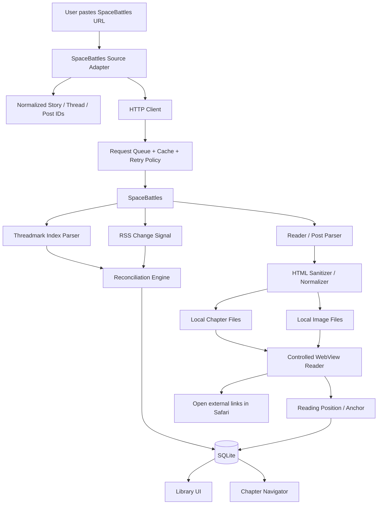
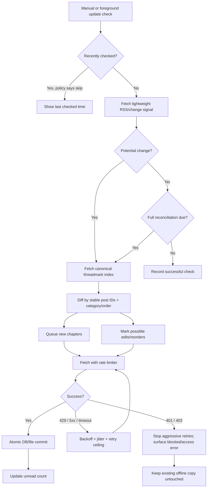

# Personal-Use iPhone Reader for SpaceBattles Fanfiction

## Executive summary

A **personal-use, local-first SpaceBattles reader is technically feasible**, and the best first architecture is significantly smaller than “build a new fanfiction platform.” SpaceBattles already exposes structured threadmarks, a Reader mode, and RSS controls on current story threads; FanFicFare and FicHub independently demonstrate that SpaceBattles/XenForo fiction can be converted into structured reading formats. The difficult parts are not basic rendering—they are **reliable chapter identity, update reconciliation, HTML edge cases, polite network behavior, and permissions if the app ever becomes public**. citeturn27search0turn27search2turn23view0turn23view5

The recommended first product is:

> **Paste a public SpaceBattles thread URL → discover threadmarked chapters → download sanitized content and images locally → read offline in an ebook-like interface → manually check for new threadmarks.**

For your likely development situation, I recommend **React Native + Expo + TypeScript**, with `expo-sqlite` for structured metadata, `expo-file-system` for chapter HTML and downloaded images, and `react-native-webview` for sanitized rich chapter rendering. Expo can produce iOS builds in its cloud from any development OS, whereas local iPhone builds require the Apple toolchain; that makes Expo substantially more practical than SwiftUI when developing primarily from Windows. citeturn26view3turn24search0turn25search0turn22view5

**Do not build background notifications, accounts, cloud synchronization, multiple fanfiction sites, recommendations, or a public App Store release into v0.** Background refresh on iOS is explicitly opportunistic: the OS chooses when work runs, can delay it substantially, and stops scheduled background work after the user force-quits the app. A manual/foreground “Check for Updates” workflow is therefore a better first design. citeturn22view3

The largest unresolved issue is **permission for public distribution**. Apple App Review Guideline 5.2.2 currently requires an app displaying or accessing content from a third-party service to be specifically permitted under that service's terms, with authorization supplied to Apple on request. The current SpaceBattles rules page is indexed, but direct retrieval of its full terms was blocked by HTTP 403 during this research, so I could **not verify a current provision authorizing or prohibiting automated reader clients**. That must remain an explicit unresolved gate—not an assumption that scraping is allowed. citeturn23view7turn21search2

For a **personal build**, this permission issue need not stop the technical prototype, but personal use is not a blanket legal exemption. Keep it conservative: public pages only, no login bypasses, no Cloudflare/access-control circumvention, no redistribution server, slow/cached requests, and an easy “Open on SpaceBattles” path. A public/App Store version should not proceed until SpaceBattles' current terms have been reviewed directly and the required authorization question is resolved. citeturn23view7

### Recommended decisions at a glance

| Area | Recommendation |
|---|---|
| Primary source | **SpaceBattles only for v0** |
| Other sites | Architect adapters for later; **support remains unspecified** |
| Stack | **React Native + Expo + TypeScript** |
| Chapter discovery | Parse SpaceBattles threadmarks; use Reader mode where useful |
| RSS | **Change signal, not canonical database** |
| Chapter identity | Stable SpaceBattles thread ID + **post ID**, never chapter position |
| Offline metadata | SQLite |
| Chapter bodies/images | App document/file storage |
| Reader | Sanitized local HTML in WebView |
| JavaScript from source | **Never execute it** |
| Updates | Manual/foreground reconciliation first |
| Background refresh | Later, best-effort only |
| Notifications | Later; never promise immediate alerts in local-only architecture |
| Networking | Serialized/low-concurrency requests, caching, backoff |
| Authentication | Public content only in v0 |
| Central server | **None** |
| Public release | Deferred pending SpaceBattles permissions and Apple review analysis |
| Personal iPhone build | Expo Go for early prototypes; development build once native behavior matters |

## Feasibility, stack, and product boundaries

### Feasibility checklist

The project should be treated as feasible only when these gates are demonstrated **on your actual iPhone**, rather than inferred from desktop scripts.

| Gate | What must be proven | Acceptance test | Risk |
|---|---|---|---|
| URL recognition | App can normalize a normal SpaceBattles thread URL | Paste URL with slug/query/fragment variations; all resolve to one story identity | Low |
| Threadmark discovery | All expected threadmark categories and entries can be enumerated | Compare app list manually with SB's threadmark UI | Medium |
| Stable identity | Reordering/renaming does not create duplicate chapters | Change fixture order/title; same source post remains same chapter | Medium |
| Chapter extraction | Story body is separated from forum chrome | Compare representative posts line-by-line/visually | Medium |
| Rich formatting | Bold, italics, quotes, scene breaks, spoilers, links and images remain usable | Golden rendering fixtures + physical-device visual check | Medium-high |
| Offline reading | Downloaded fic opens with network disabled | Force-quit app, enable airplane mode, relaunch, navigate chapters/images | Low-medium |
| Position persistence | Reader resumes meaningfully after typography/layout changes | Read midway, close app, change font, reopen near same paragraph | Medium |
| Update detection | New chapters are added without duplication | Run update twice; second run is idempotent | Medium |
| Failure safety | A failed refresh cannot destroy existing content | Inject timeout/403/500 halfway through update; old copy remains readable | Medium |
| Network politeness | Import does not hammer SpaceBattles | Request queue, caching, backoff, observable logs | Medium |
| Personal installation | App works without development machine attached | Launch independently and complete offline acceptance test | Low-medium |
| Public-release permission | SpaceBattles access/display rights satisfy Apple 5.2.2 | Current terms reviewed and authorization evidence available | **High / unresolved** |

Current SpaceBattles pages visibly expose **Threadmarks, Reader mode and RSS**, and FanFicFare has active XenForo/SpaceBattles handling for threadmark categories, Reader mode and unusual chapter lists. That makes the underlying extraction problem well precedented, although a current August 2026 FanFicFare issue involving an HTTP 403 on a particular older SpaceBattles post shows why the importer must expect per-story failures. citeturn27search2turn23view0turn23view1turn23view2turn28search0

### React Native + Expo versus SwiftUI

For **this project**, React Native/Expo has the better cost-to-friction ratio.

| Consideration | React Native + Expo/TypeScript | SwiftUI |
|---|---|---|
| Windows-centered development | **Strong advantage.** EAS can compile iOS builds in the cloud from any OS. citeturn26view3 | Local iOS development depends on Xcode/macOS |
| Cross-platform option later | Strong | Requires separate Android implementation |
| SQLite/files/WebView | Mature Expo modules or supported RN packages. citeturn24search0turn25search0turn22view5 | Excellent native equivalents |
| iOS-native integration | Good | **Best** |
| Reader prototype speed | **Strong** | Strong if already comfortable with Swift |
| Future highly customized native typography | Possible, sometimes more work | **Strong advantage** |
| Recommendation | **Use this** | Reconsider only if project becomes permanently Apple-only and you have a Mac/Xcode workflow |

Expo explicitly recommends development builds when creating an app intended to become a real installed application, while Expo Go is useful for initial TypeScript iteration. Current Expo documentation says EAS cloud compilation can create iOS builds from any operating system; local iPhone development builds require the native Apple toolchain, and Expo identifies local compilation as the only route to installing such a build without a paid Apple Developer account. citeturn26view3

Apple currently charges **US$99 per membership year** for the Apple Developer Program. For a Windows-based workflow needing a signed custom iPhone build through EAS, budget for that once you outgrow Expo Go rather than buying it before the first prototype proves valuable. citeturn20search4turn26view4

### Proposed architecture



The important design principle is the **source adapter boundary**. Everything SpaceBattles-specific—URL patterns, threadmarks, categories, Reader mode quirks—belongs behind one adapter. The library, database and reader should consume a normalized model. FanFicFare already demonstrates that multiple XenForo sites share enough structure to reuse common machinery, but because you have not specified which other sources you want, **no second website belongs in the initial scope**. citeturn23view0turn23view1

## Importing, rendering, and updating stories

### Importer design

Use the SpaceBattles threadmark structure as the authoritative **table of contents**, and individual posts/Reader pages as content sources.

A practical import pipeline is:

1. Normalize the submitted URL and extract the numeric **thread ID**.
2. Load enough of the thread to identify metadata and threadmark controls.
3. Enumerate threadmark categories and entries.
4. Normalize each chapter around the underlying **post ID**.
5. Download only the selected categories.
6. Parse the post body into an allowlisted HTML representation.
7. Download permitted inline images locally.
8. Commit metadata and files atomically.
9. Open the first unread chapter.

FanFicFare's current XenForo configuration is an especially valuable implementation reference. It recognizes categories such as **Threadmarks, Sidestory, Apocrypha, Media and Informational**, handles configurable category ordering, notes that site order and timestamps can disagree, and includes logic for duplicate SpaceBattles chapter URLs. Its Reader-mode support exists specifically to reduce the number of pages needed for a full threadmarked-story download. citeturn23view0turn23view1turn23view2

That leads to two important rules:

**Do not derive chapter identity from chapter number or list position.** Authors can rename, insert and reorder entries.

**Do not assume datetime sorting reproduces author intent.** Preserve the site's threadmark order separately from publication timestamps. FanFicFare explicitly documents cases where post order and datetime order disagree. citeturn23view1

### RSS should be an accelerator, not the database

SpaceBattles currently exposes an RSS control alongside threadmarks and Reader mode on live threads. citeturn27search0turn27search3

Use it this way:



The canonical reconciliation step matters because RSS feeds are optimized for syndicating recent changes, not necessarily for reproducing an entire durable chapter database. FanFicFare's historical SpaceBattles support has encountered RSS-related completeness/order issues, while its current XenForo configuration instead contains substantial direct threadmark/Reader-mode handling. The safe architecture is therefore to let RSS tell you **“something may have changed”**, then reconcile against threadmarks. citeturn23view0turn23view1

### Rate limiting and retries

There is no verified SpaceBattles request-rate quota in the materials retrieved for this report, so **do not invent one**.

Instead, set a conservative client policy:

| Condition | Recommended behavior |
|---|---|
| Normal import | One small request queue; avoid large parallel bursts |
| Same URL already fetched | Reuse cached result during the current operation |
| 429 | Respect `Retry-After` when supplied; exponential backoff otherwise |
| 5xx / timeout | Bounded exponential backoff with jitter |
| 401 / 403 | Stop repeated automatic retries; explain that access was refused |
| Network loss | Pause queue; keep successfully committed chapters |
| User cancels | Stop new work; leave completed downloads usable |
| Parser fails | Save diagnostic metadata but never save empty content as “success” |
| Refresh fails | Preserve prior offline content and prior reading position |

This is consistent with FicHub's own stated strategy: it **caches content and throttles upstream requests** specifically to behave responsibly toward supported sites, including SpaceBattles. citeturn23view5

A proposed product-level cooldown—for example, avoiding repeated automatic checks of the same story within a short period—is sensible, but it should be documented as **your application's politeness policy, not an official SpaceBattles limit**.

### FanFicFare and FicHub compatibility

Treat both as references and interoperability targets rather than hard runtime dependencies.

**FanFicFare** is the strongest parsing reference. Study its XenForo logic for Reader mode, threadmark categories, duplicate URLs, spoilers, images, link normalization and update behavior. FanFicFare's current configuration says Reader mode can reduce the number of pages fetched for a full story by roughly an order of magnitude, and it exposes numerous edge-case controls developed from years of actual fanfiction conversion. citeturn23view0turn23view2

**FicHub** is useful as a compatibility benchmark and possible future import/export bridge. It currently lists SpaceBattles, Sufficient Velocity and Questionable Questing among supported XenForo sources and exports common ebook formats. citeturn23view5

For v0, I would **not route every read through FicHub**. That would add a third-party server, weaken the local-first privacy model, and give you less control over freshness. Instead:

> Direct SpaceBattles adapter → local library

Later:

> EPUB import/export ↔ FanFicFare/FicHub-generated files

That gives users a fallback if direct parsing breaks without making the reader dependent on another service.

### Test-story matrix

You have **not supplied the specific SpaceBattles stories you want used as fixtures**, so this report deliberately does not assume titles. Before importer implementation, supply real examples fitting these profiles; only public stories should be used for the initial test set.

| Fixture | Required characteristics | What it tests |
|---|---|---|
| Story A | Ordinary public fic, only main Threadmarks | Happy-path import |
| Story B | Very large fic / many threadmarks | Pagination, memory, request count, performance |
| Story C | Threadmarks + Sidestory + Apocrypha + Informational | Category separation and ordering |
| Story D | Heavy formatting, spoilers, quotes, links, scene breaks | HTML fidelity |
| Story E | Inline images/media | Asset downloading and offline behavior |
| Story F | Actively updating | Update reconciliation and unread state |
| Synthetic fixture | Duplicate/reordered/renamed entries | Stable identity and idempotency |
| Failure fixture | Simulated 403/429/timeout/malformed HTML | Error handling |

A production test suite should store **small handcrafted/synthetic HTML fixtures** rather than checking entire copyrighted stories into the repository. Real stories are best treated as integration tests performed against their live public URLs where permitted.

### WebView versus native text

For v0, use a **controlled WebView containing sanitized local HTML**.

This is not “put SpaceBattles inside a WebView.” The website chrome never enters the reader. `react-native-webview` supports rendering inline HTML inside a native view and is included in Expo Go, making it suitable for an early reader prototype. citeturn22view5

The pipeline should be:

> source HTML → DOM parse → extract post body → sanitize → normalize → rewrite image/link URLs → save local HTML → render with your CSS

Preserve, at minimum, semantic paragraphs, bold/italics, headings when authors use them, blockquotes, lists, links, horizontal/scene breaks, images, tables where practical, and spoiler containers. FanFicFare itself has multiple spoiler-output strategies and numerous HTML-normalization accommodations, which is good evidence that forum fiction has enough formatting variability to make a simple native `Text` reconstruction deceptively expensive. citeturn23view3turn23view2

For v0, **native text loses** because you would immediately need to reconstruct HTML layout, nested formatting, spoilers, image sizing and selection semantics yourself. Reevaluate native rendering only if WebView produces measurable accessibility, pagination or position-tracking problems.

## Offline model, identity, and reading state

### Storage split

`expo-sqlite` currently provides persistent SQLite storage across application restarts, while Expo FileSystem provides app-local file and directory APIs including document and cache locations. citeturn24search0turn25search0

Use them differently:

**SQLite owns facts and relationships.**  
**Files own potentially large bodies/assets.**

Do not make the database one enormous collection of HTML/image BLOBs unless testing proves there is a compelling reason.

For guaranteed offline chapters and images, use durable app document storage rather than treating them as disposable caches. FileSystem exposes both document and cache paths, so that distinction is straightforward to implement. citeturn25search0

### Data model sketch

| Table | Important fields | Purpose / invariant |
|---|---|---|
| `stories` | `id`, `source`, `source_thread_id`, `canonical_url`, `title`, `author_name`, `author_source_id?`, `added_at`, `last_checked_at`, `source_updated_at?`, `import_status` | `(source, source_thread_id)` unique. URL slug changes must not create a new story. |
| `chapters` | `id`, `story_id`, `source_post_id`, `canonical_url`, `author_name`, `title`, `published_at?`, `edited_at?`, `content_path?`, `content_hash?`, `word_count?`, `fetch_state`, `fetched_at`, `last_error?` | `(story_id, source_post_id)` unique. Post identity is independent of title/order. |
| `threadmarks` | `id`, `story_id`, `chapter_id`, `source_threadmark_id?`, `category_key`, `category_label`, `source_position`, `display_title`, `discovered_at`, `removed_at?` | Classification/order layer. Do not encode category/order into chapter identity. |
| `assets` | `id`, `chapter_id`, `source_url`, `local_path`, `mime_type`, `content_hash?`, `byte_size?`, `fetch_state`, `last_error?` | Maps remote media to durable local copies. |
| `reading_positions` | `story_id`, `chapter_id`, `block_anchor?`, `text_offset?`, `scroll_ratio_fallback`, `updated_at` | One current resume position per story; use semantic anchor before percentage. |
| `story_progress` | `story_id`, `last_read_chapter_id`, `furthest_read_position?`, `unread_count` | Separates “resume” from chapter ordering changes. |
| `sync_runs` | `id`, `story_id`, `trigger`, `started_at`, `finished_at?`, `status`, `retry_count`, `summary`, `error_class?` | Auditable update/import history without polluting chapter rows. |
| `source_state` | `story_id`, `rss_url?`, `last_feed_token?`, `etag?`, `last_modified?`, `last_full_reconcile_at?` | Optimization state only; never canonical story truth. |
| `settings` | reader typography/theme/category defaults | Local preferences; no account required. |

### Stable identity

The core rule should be:

```text
Story identity   = source + numeric thread ID
Chapter identity = story identity + numeric source post ID
Ordering         = mutable metadata
Title            = mutable metadata
Category         = mutable relationship
Content          = versionable payload
```

FanFicFare's configuration itself shows SpaceBattles chapter links in both direct `/posts/<id>/` and thread-fragment `#post-<id>` forms, and it documents duplicate chapter URLs observed on SpaceBattles. Normalize both forms to the underlying source post ID before deduplication. citeturn23view2

This solves several otherwise nasty cases:

**Rename:** same post ID → update title, preserve progress.

**Reorder:** same post ID → update `source_position`, preserve content/progress.

**Category move:** update threadmark relationship; do not duplicate chapter.

**Duplicate threadmark:** same chapter can be referenced more than once; deduplicate reading payload while retaining source relationships where meaningful.

**Deletion:** mark the source reference missing/removed; do not immediately erase the user's offline copy.

**Edit:** same chapter identity, new `content_hash`; update content only after successful complete fetch.

Perfect edit detection should **not** be promised in v0. SpaceBattles pages can expose “last edited” information, but you should not assume every feed/index gives enough information to detect every historical edit. citeturn27search3turn27search9

### Position tracking

Do not persist only `scrollY=18,472` or `57.2%`.

A font-size change, device rotation, inserted image or edited paragraph invalidates raw pixel coordinates. Instead inject stable local anchors at paragraph/block boundaries during sanitation:

```text
chapter
  block-0001
  block-0002
  block-0003
  ...
```

Persist something like:

```text
chapter_id
block_anchor = block-0042
in_block_text_offset = 183
scroll_ratio_fallback = 0.574
```

On resume, locate the semantic block first and use the ratio only when that anchor disappeared because the chapter was edited. This is an architectural recommendation, not a SpaceBattles requirement.

## Minimal release plan and later backlog

### Minimal v0

The smallest version worth using should contain only:

| Capability | v0 requirement |
|---|---|
| Add story | Paste one public SpaceBattles thread URL |
| Library | Title, author, reading progress, downloaded/update state |
| Contents | Main threadmarks plus visible category grouping |
| Reader | Scroll reading, font size, line height/margins, light/dark theme |
| Formatting | Paragraphs, emphasis, quotes, links, spoilers, images, scene breaks |
| Offline | Downloaded chapter text and images survive full relaunch offline |
| Position | Resume by chapter + semantic content anchor |
| Updates | Manual “Check for Updates” |
| Errors | Per-story/chapter errors, retry control, old copy retained |
| Source access | “Open on SpaceBattles” action |
| Privacy | No account, analytics, cloud content store or backend |

**Paged/page-turn reading is not a v0 requirement.** Reliable pagination of arbitrary rich HTML complicates positioning and layout significantly; prove that the scrolling experience is good first.

### Milestones with acceptance criteria

Effort is expressed as **S/M/L**, not calendar time. These are relative engineering estimates for a solo AI-assisted project; legal/permission work is not estimable as code effort.

| Milestone | Deliverable | Acceptance criterion | Effort | Risk |
|---|---|---|---|---|
| Feasibility spike | Static reader + one parser fixture | Real iPhone displays sanitized sample content pleasantly | S | Low |
| Local reader | Library, chapter nav, SQLite, files, position | Force-quit/reopen/offline tests pass | M | Low-medium |
| SpaceBattles importer | URL normalization, threadmark parsing, chapter extraction | Story A/C/D fixtures match site contents and formatting | L | **Medium-high** |
| Robust downloads | Images, queue, cancellation, retries, atomic writes | Injected failures never corrupt usable library | M | Medium |
| Stable reconciliation | Diff by post IDs, reorder/category handling | Synthetic reorder/rename/duplicate tests remain idempotent | M | Medium |
| Personal v0 | Manual updates + polished reader controls | You voluntarily prefer it to Safari for normal reading | M | Medium |
| Reliability pass | Giant stories, malformed pages, 403/429, migration tests | Test matrix passes without data loss | M-L | Medium-high |
| Optional background updates | Best-effort BGTaskScheduler integration | Missed/delayed runs are handled honestly | M | Medium |
| Public beta | Permission/compliance work + TestFlight | Legal/App Review gates satisfied first | L | **High** |

The **personal v0 acceptance criterion should be experiential**, not merely technical: after several genuine reading sessions, you prefer opening this reader to opening the SpaceBattles browser interface.

### Prioritized backlog

| Priority | Later capability | Why it waits |
|---|---|---|
| High | Share-sheet “Open in Reader” | Great convenience after URL import is reliable |
| High | EPUB import/export | Excellent FanFicFare/FicHub interoperability and backup route |
| High | Backup/restore library metadata and progress | Valuable once real reading history accumulates |
| High | Full-text chapter search | SQLite FTS support is available; unnecessary for core proof. citeturn24search0 |
| Medium | Best-effort background refresh | iOS cannot guarantee timing. citeturn22view3 |
| Medium | Local notifications after successful background discovery | Useful but inherits background timing uncertainty |
| Medium | “Refresh edited chapter” / revision history | Requires more source requests and careful diff UX |
| Medium | Page-turn pagination | More reader/layout complexity |
| Medium | Custom category/read-order controls | Useful for omakes and side stories after basic categories work |
| Medium | Highlights/bookmarks/notes | Valuable reader feature, unrelated to importer feasibility |
| Medium | Accessibility/VoiceOver optimization beyond baseline | Should be tested throughout; advanced controls later |
| Low | iCloud sync | Introduces cloud/privacy/conflict complexity |
| Low | Android | Architecture can accommodate it; no reason to build before iPhone v0 succeeds |
| Unspecified | Sufficient Velocity / AO3 / Royal Road / others | **User has not chosen secondary sources** |
| Avoid initially | Server-side recommendations/discovery | Turns a private reader into a content service with much larger compliance/privacy scope |
| Avoid initially | Near-real-time server push | Requires backend monitoring and conflicts with local-only design |

## Security, privacy, permissions, and release

### Security/privacy checklist

A fanfiction post is **untrusted remote content** even when it comes from a site you trust operationally. The safest reader treats downloaded HTML as data, never executable application code.

| Control | Required practice |
|---|---|
| HTML sanitation | Parse into a strict allowlist; discard `<script>`, event handlers and unsupported embeds |
| JavaScript | Never execute JavaScript obtained from SpaceBattles |
| WebView | Render only app-generated/sanitized local HTML |
| Links | Intercept navigation; external links open deliberately in Safari |
| Images | Validate scheme/MIME/size; store under app-controlled filenames |
| File paths | Generate them locally; never derive arbitrary filesystem paths directly from remote strings |
| SQL | Use bound parameters/prepared statements, not interpolated user/source strings; Expo specifically warns about SQL injection and recommends parameterized/prepared operations. citeturn24search0 |
| Authentication | Public stories only in v0; do not capture SpaceBattles passwords |
| Cookies | Do not copy Safari/session cookies into the app merely to defeat access failures |
| 403/access controls | Stop and report—not bypass |
| Networking | HTTPS only; no hidden proxy service |
| Story storage | On-device only |
| Telemetry | None by default; diagnostics should be explicit and redact story text/URLs where practical |
| Backups | User-controlled export later |
| Deletion | “Remove download” and “Remove from library” must have predictable semantics |
| WebView source | No arbitrary remote pages inside the reading WebView |
| Third-party SDKs | Minimize them, especially analytics/ad SDKs |

Apple's review rules also prohibit an app from downloading executable code that changes app functionality. Sanitized story HTML must therefore remain **content**, not a mechanism for executing remote scripts or code. citeturn22view1

### Background work and notifications

Expo's current BackgroundTask implementation uses Apple's `BGTaskScheduler`. On iOS, the OS—not the app—chooses the actual execution time based on conditions including battery, connectivity and usage patterns; jobs may run later than the configured minimum, and swiping the app away terminates them until the app is reopened. Expo also says iOS background tasks require testing on physical hardware rather than the simulator. citeturn22view3

Therefore:

> **Manual and foreground update checks are authoritative. Background checking is only an opportunistic optimization.**

A local-only app can show a local notification **after** it happens to discover new chapters in background execution. It cannot honestly promise “notify me the moment the author posts” without a continuously available remote service monitoring sources and sending push notifications.

That server would materially change the privacy/legal architecture: it would centrally access SpaceBattles on users' behalf and know what users follow. Unless near-real-time alerts become extremely important, do not add it.

### SpaceBattles permissions

This is the area where research produced a **deliberate unresolved answer**.

The current SpaceBattles search index exposes a “Site rules including terms of service” page and its snippet says users should not violate copyright or claim others' works as their own. However, opening the current rules page through this research environment returned an access error, and searches did not expose a reliable current clause covering automated clients, scraping, offline reader apps, or allowed request rates. citeturn21search2

Accordingly, none of the following should be asserted:

> “SpaceBattles allows scraping.”

> “SpaceBattles forbids all scraping.”

> “X requests per second is approved.”

> “Personal use makes the terms irrelevant.”

The correct release process is to **manually inspect the current SpaceBattles terms/rules immediately before implementation that depends on automated access and again before any public distribution**. For a public app, seek explicit clarification from SpaceBattles staff if the terms do not clearly authorize this usage.

FanFicFare and FicHub successfully supporting SpaceBattles is **evidence that the technical approach exists**, not legal authorization for a new app. citeturn23view5turn23view0

### Apple App Store considerations

For personal use, **do not make App Store submission a project requirement**. Apple's current guidelines explicitly say the App Store is not the best distribution path for an app intended just for family and friends, pointing instead to local Xcode installation or Ad Hoc distribution for program members. citeturn26view0

If the project later becomes public, several review areas become significant:

**Third-party content permission is the primary gate.** Guideline 5.2.2 says an app using, accessing or displaying third-party-service content must be specifically permitted under that service's terms, and authorization has to be provided if Apple asks. Guideline 5.2.1 separately addresses trademarks and copyrighted third-party material. citeturn23view7

**Do not brand it as an official SpaceBattles client.** Use a neutral product name and describe SpaceBattles as a supported source only when appropriate authorization exists. Apple's IP guidelines prohibit misleading or copycat representations involving third-party protected material. citeturn23view7

**Provide meaningful reader functionality.** Apple says apps should not primarily be web clippings, content aggregators or simple collections of links. A native/local library with offline content, reading position, typography, chapter navigation and update state is a substantially stronger product proposition than a thin WebView wrapper. citeturn23view7

**User-generated-content rules may become relevant.** A public reader capable of displaying arbitrary content from a web-based user-content service can implicate Apple's UGC requirements, including objectionable-content handling; Apple also has specific conditions around incidental mature web-service content. The exact application to a read-only importer should be evaluated at submission time rather than assumed away. citeturn26view1

A sensible release ladder is therefore:

```text
Expo Go proof
       ↓
Private development build on your iPhone
       ↓
Personal-use v0
       ↓
Permission / terms review
       ↓
Small private TestFlight or Ad Hoc test, if appropriate
       ↓
Only then consider App Store submission
```

TestFlight is a beta-distribution mechanism, not a way to circumvent platform or content rules. Apple currently supports TestFlight through Developer Program membership and allows large external betas, but a personal-use project does not need to go there until other testers actually matter. citeturn26view4

### Open-source licensing

**Study FanFicFare; do not blindly copy it.**

FanFicFare is especially useful because its source contains years of XenForo/SpaceBattles edge-case knowledge. Its repository's licensing is not uniform in the simplistic sense of “everything is Apache”: the project license distinguishes Apache-licensed portions such as the core `fanficfare`/webservice code from GPL-covered Calibre-plugin components. Before copying implementation code rather than merely learning from its behavior, identify the particular source file and comply with its applicable license/notices. citeturn3search1

For a small personal project, the easiest posture is often:

> **Reimplement the data model and parser behavior from documented observations/tests; use FanFicFare as a behavioral reference; only copy code when there is a concrete benefit and its licensing obligations have been reviewed.**

## Recommended implementation blueprint and source list

### Concrete v0 blueprint

The project should begin with these modules:

```text
src/
  sources/
    SourceAdapter.ts
    spacebattles/
      SpaceBattlesAdapter.ts
      urls.ts
      threadmarks.ts
      posts.ts
      rss.ts
      fixtures/

  network/
    client.ts
    requestQueue.ts
    retryPolicy.ts

  content/
    sanitize.ts
    normalizeHtml.ts
    assets.ts
    anchors.ts

  storage/
    database.ts
    migrations/
    repositories/
    files.ts

  reader/
    ReaderScreen.tsx
    readerTemplate.ts
    reader.css
    positionBridge.ts

  library/
    LibraryScreen.tsx
    StoryScreen.tsx

  sync/
    reconcile.ts
    updateStory.ts

  tests/
    integration/
    failures/
```

Define the source interface before writing the SpaceBattles implementation:

```ts
interface SourceAdapter {
  canHandle(url: string): boolean;
  normalizeStoryUrl(url: string): Promise<StoryIdentity>;
  fetchStoryMetadata(story: StoryIdentity): Promise<StoryMetadata>;
  fetchThreadmarks(story: StoryIdentity): Promise<SourceThreadmark[]>;
  fetchChapter(chapter: SourceChapterIdentity): Promise<RawChapter>;
  checkForChanges(story: StoryIdentity): Promise<ChangeHint>;
}
```

That keeps other-site support possible while making **zero commitment** to which other sites will actually be supported.

The most important invariants to put into tests on day one are:

```text
same thread ID   => same story
same post ID     => same chapter
new title        ≠ new chapter
new list index   ≠ new chapter
failed refresh   ≠ lost old content
RSS says nothing ≠ absolute proof nothing changed
offline          = no network dependency
```

### Prioritized sources to keep beside the project

**Highest priority — SpaceBattles itself**

[SpaceBattles Site Rules / Terms](https://forums.spacebattles.com/pages/site-rules/) — review manually before relying on automated retrieval and again before public distribution. The page exists in SpaceBattles' current index, although its full contents could not be retrieved by this research environment. citeturn21search2

A representative current thread, such as [Bandersnatch](https://forums.spacebattles.com/threads/bandersnatch-an-scs-fanfic.1317184/), demonstrates the present Threadmarks / Reader mode / RSS user-facing structure. It should **not** automatically become one of your test stories unless you actually want it in the test library. citeturn27search2

**Highest priority — existing importer behavior**

[FanFicFare](https://github.com/JimmXinu/FanFicFare) is the strongest open-source reference for XenForo threadmarks, Reader mode, categories, duplicate URLs, spoilers and numerous long-tail fanfiction conversion problems. Its current configuration is particularly valuable as a catalogue of edge cases. citeturn23view0turn23view1turn23view2

[FicHub](https://fichub.net/) is a valuable interoperability and operational reference. It explicitly supports SpaceBattles and states that it caches and throttles upstream requests. citeturn23view5

**Highest priority — Apple release constraints**

[Apple App Review Guidelines](https://developer.apple.com/app-store/review/guidelines/) — especially 1.2, 4.2.2 and **5.2.2**. For any eventual public SpaceBattles client, 5.2.2 is the release requirement to resolve first. citeturn23view7turn26view1

[Apple Developer Program](https://developer.apple.com/programs/) — current membership/distribution options and pricing. citeturn26view4

**Highest priority — chosen technical stack**

[Expo Development Builds](https://docs.expo.dev/develop/development-builds/introduction/) — explains Expo Go versus a real development build and confirms EAS cloud iOS compilation from any OS. citeturn26view3

[Expo SQLite](https://docs.expo.dev/versions/latest/sdk/sqlite/) — persistent local relational storage. citeturn24search0

[Expo FileSystem](https://docs.expo.dev/versions/latest/sdk/filesystem/) — durable chapter/image file management and download primitives. citeturn25search0

[Expo WebView](https://docs.expo.dev/versions/latest/sdk/webview/) — local/inline rich HTML rendering. citeturn22view5

[Expo BackgroundTask](https://docs.expo.dev/versions/latest/sdk/background-task/) — definitive reminder that iOS background refresh is OS-scheduled and non-deterministic. citeturn22view3

### Recommended go/no-go decision

**Go** on the personal prototype.

The technical architecture has sufficient precedent: SpaceBattles exposes structured threadmark/Reader/RSS functionality today; both FanFicFare and FicHub support SpaceBattles; Expo supplies the required local database, filesystem, WebView and iOS-build infrastructure. citeturn27search0turn23view0turn23view5turn24search0turn25search0

But make the project conditional on three checkpoints:

| Checkpoint | Proceed when… | Stop/rethink when… |
|---|---|---|
| Reader checkpoint | Sanitized local chapter is materially nicer to read than Safari | WebView reader feels worse and a native renderer would exceed the project's value |
| Importer checkpoint | Representative public stories import reliably without aggressive networking or access workarounds | Normal usage routinely requires bypassing blocks/authentication or brittle hacks |
| Release checkpoint | Current SpaceBattles terms/permission satisfy intended distribution and Apple 5.2.2 | Authorization cannot be established for public distribution |

The immediate target is therefore **not** an App Store product. It is a private reader with one supported source, excellent offline behavior, stable post-based chapter identity, a conservative importer, and a reading experience good enough that you stop wanting to open the fic in Safari.

The only test input intentionally left unresolved is **which actual SpaceBattles stories you want to use as Story A–F**. Those examples are user-specific and were not supplied, so they should be selected before importer implementation rather than guessed now.